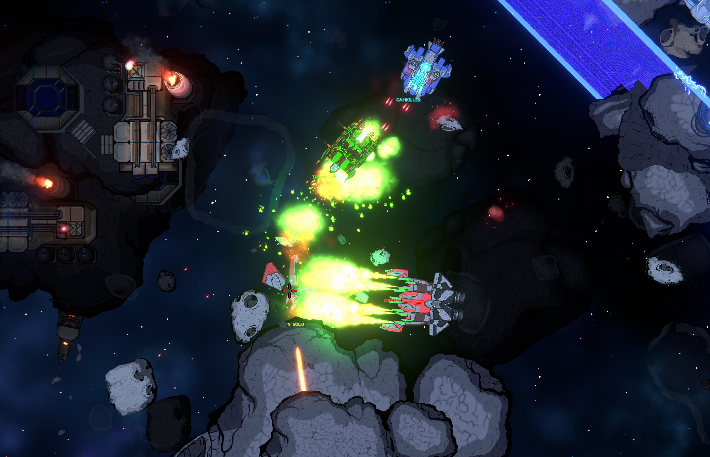
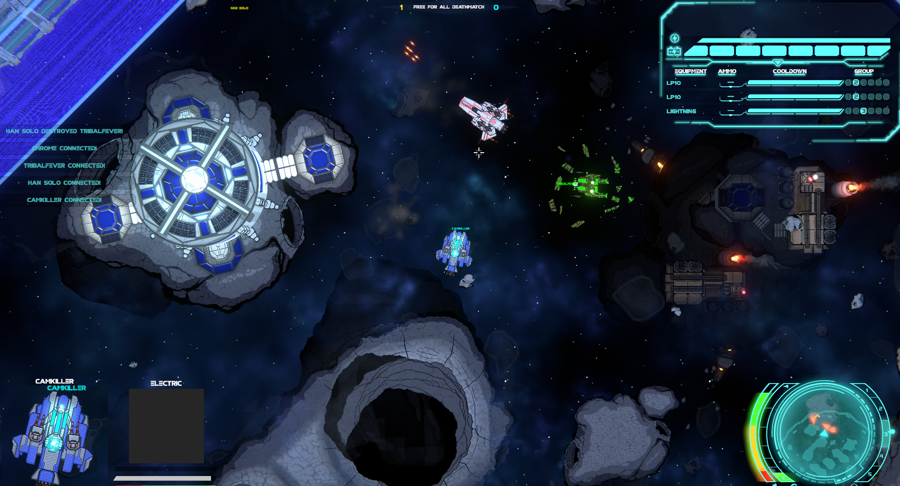
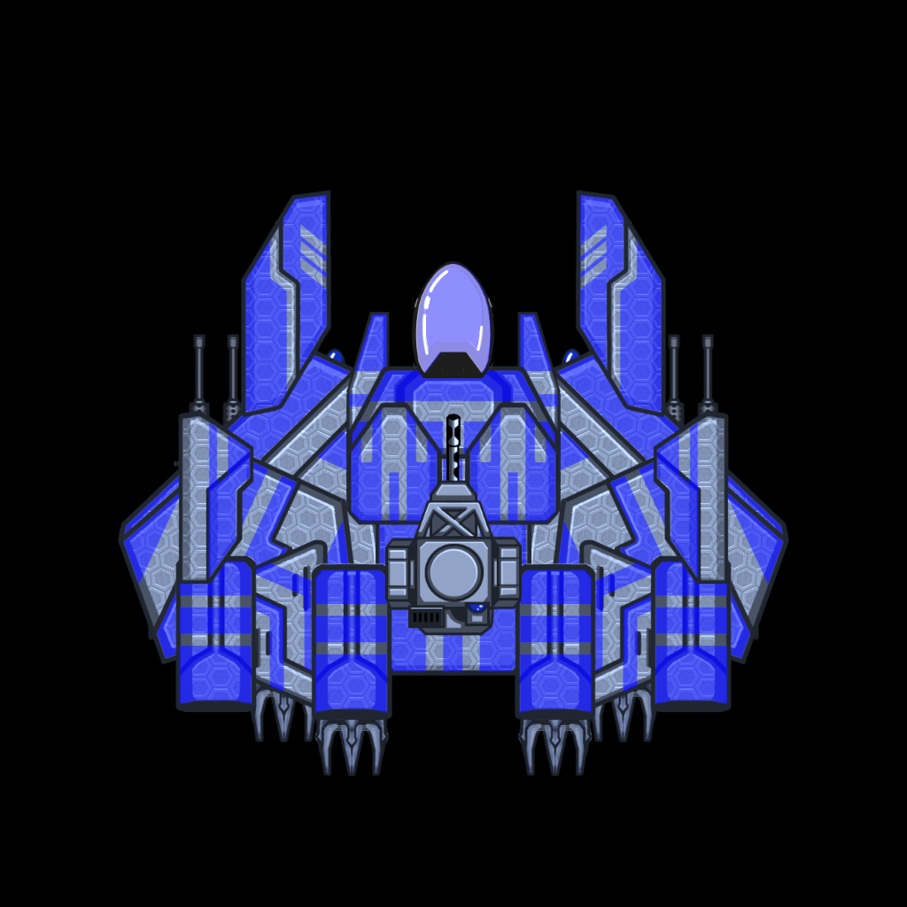
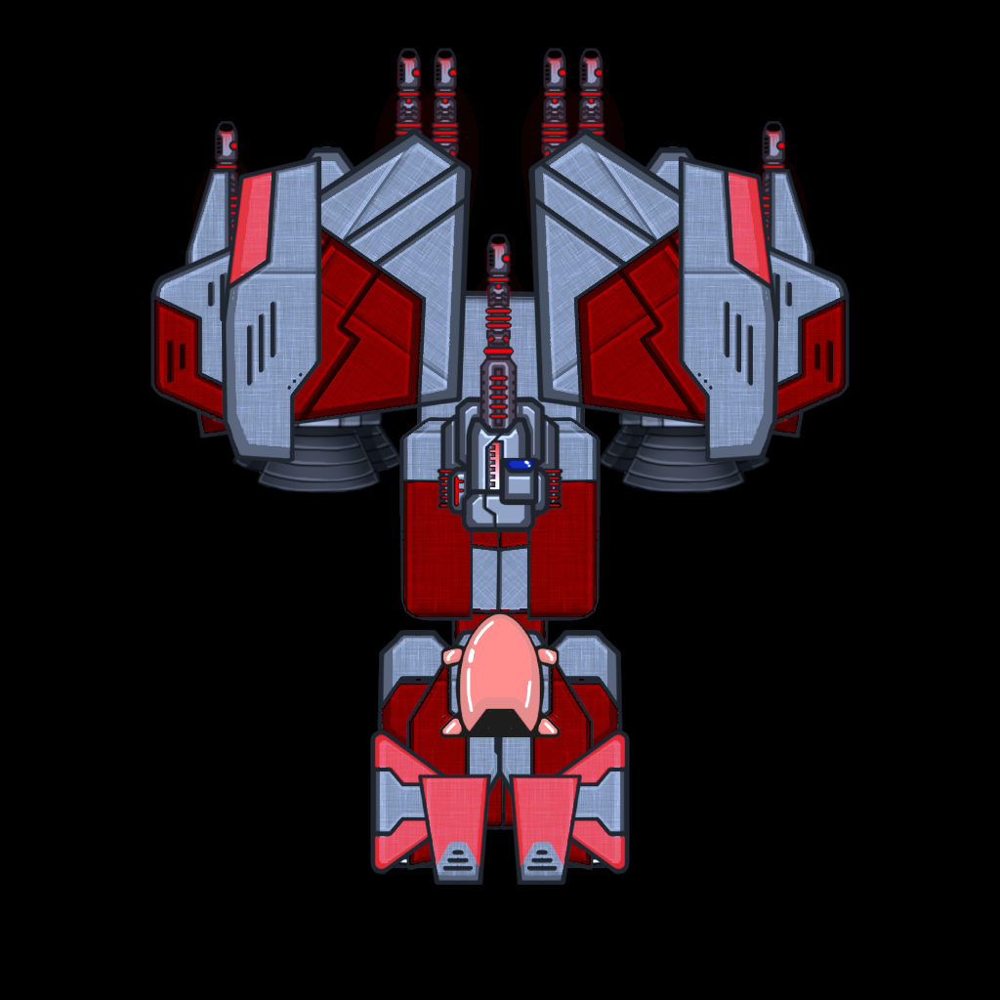
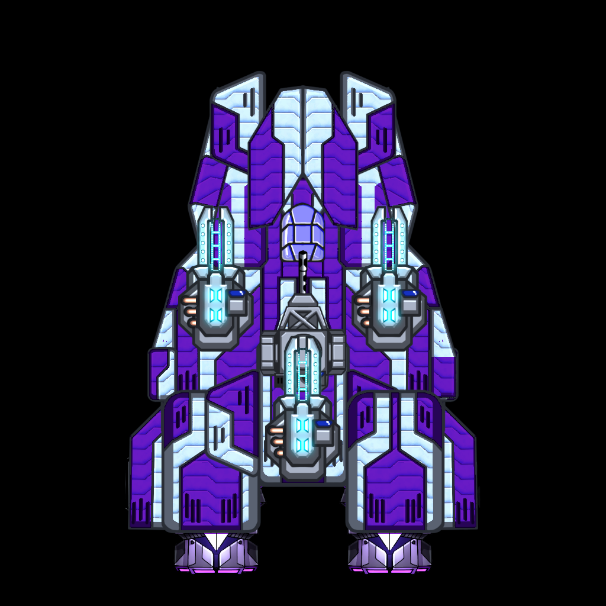

# 🔥 Ignition: Arena

**A multiplayer arena game built in Unity by indie studio Expedition Games.**

*Ignition: Arena* is a free-to-play, fast-paced tactical PvP game where players build and customize ships for intense space battles. Compete in dynamic arenas featuring strategic combat, skill-based mechanics, and extensive ship customization. Outsmart and outgun opponents to claim victory!
<!--

 -->

   <i>▶ <a href="https://www.youtube.com/watch?v=5j59W-2gOZ0">Watch the trailer</a> · <a href="https://store.steampowered.com/app/3228760/Ignition_Arena/">Play free on Steam</a></i> 

   
  <i>Close-quarters combat in an asteroid field</i>

> **About this repo:** *Ignition: Arena* is closed source. This repository is a public overview of the project, its features, and how its core systems work.

---

## Features

- **Online multiplayer:** Up to 6 players are matched to play a 10 minute round 
- **AI opponents:** bots fill empty slots or offer solo play
- **Full match flow:** lobby, countdown, rounds, and results
- **Unique layered 2D maps and flight:** Players fight on 5 layers, moving between layers as they fly, making 3rd dimensional movement important in 2D
- **Original art direction:** <!-- TODO: e.g. "a bold neon palette built for readability in hectic fights" -->

   
  <i>A free-for-all deathmatch, with the equipment HUD, kill feed, and radar</i>

## How it works

**Multiplayer networking** Server-Client architecture using Unity Cloud and Matchmaker backend. Client prediction and reconciliation aids in making networked physics ships feel responsive and have smooth movement.

**AI opponents** State machine AI that adapts to the ship it's piloting by analyzing the optimal playstyle given a ships loadout. The state machine interacts with pathfinding and a PID controller to fly the ship.

**Ship Builder** Players drag and drop ship pieces aross multiple phases to build custom ships. Ships have physics based flight reliant on their construction.

<table>
  <tr>
    <td align="center" width="33%"></td>
    <td align="center" width="33%"></td>
    <td align="center" width="33%"></td>
  </tr>
</table>

<i>Three ships assembled in the ship builder from different components</i>

**Game loop** Players unlock ship components and construct ships. Then, they matchmake into a round. They PvP and are rewarded with in-game currency which they can then redeem for more ship components.

## Tech

| | |
|---|---|
| **Engine** | Unity |
| **Language** | C# |
| **Networking** | Netcode for GameObjects, Unity Cloud Services |
| **Platforms** |  PC (Steam) |
| **Development** | 2024 – 2026 |

## Team

*Ignition: Arena* was made by a 6-person team at **Expedition Games**.

- **Cam Knight:** Project lead, art director, designer, engineer
- **Taylor Dabrowski:** producer
- **Tayin Wallace:** engineer
- **Joshua Ortiz:** artist
- **Rachel Buzarde:** artist
- **Rebekah Knight:** writer

---

© Expedition Games. All rights reserved.
